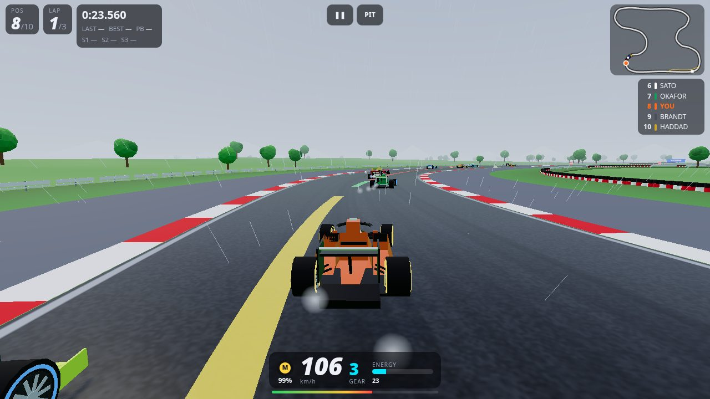
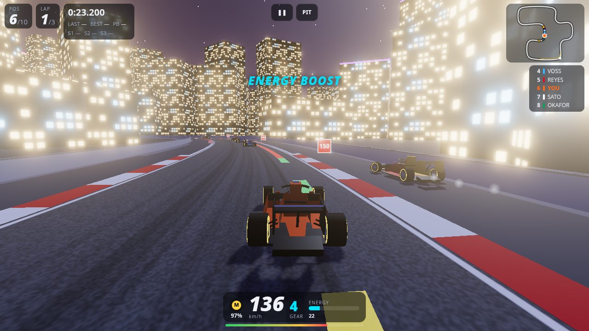
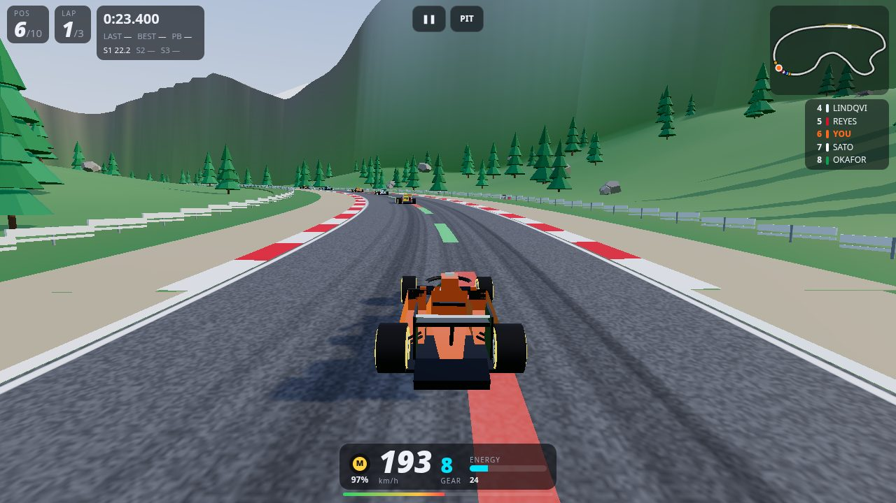
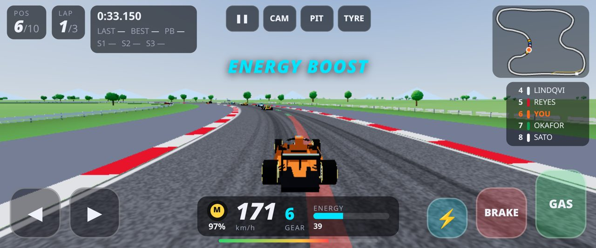

# VYRONIQ RACING

An original open-wheel (formula-style) 3D racing game for the browser, built with Three.js and tuned for phones in landscape (Android Chrome) as well as desktop.

**Play:** https://balachandarhr.github.io/vyroniq-racing/

All cars, teams, drivers, circuits and liveries are fictional. There is no official F1 branding of any kind.

## What's in V1

- **5 open-wheel cars**, classes D to S: Kestrel F4 (free), Vanta R2 (15,000), Strata FX (60,000), Zephyr XR (200,000) and Vyron Apex S (600,000 V-Coins). Each car has its own stats for top speed, acceleration, cornering, braking, downforce and weight, plus a livery editor (3 colours and 5 patterns).
- **3 original circuits:**
  - Velocity GP: modern, with long straights.
  - Neon Harbour: night street circuit with tight corners, neon and a harbour.
  - Apex Mountain: real elevation change through the hills.

  Every circuit has a start/finish line with a 5-light gantry, a grid, a pit lane, 3 timing sectors, kerbs, track limits (off-track slows you and invalidates the lap), braking boards and a mini-map.
- **Physics:** arcade-sim handling with downforce-dependent grip, drag, braking limits, slides, kerbs, gravity on slopes, barrier and car-to-car collisions, slipstream, an 8-speed gearbox (auto or manual) and tyre wear.
- **AI:** 9 fictional drivers, each with their own skill and aggression. They use exactly the same physics as you, with no rubber-banding. They brake from a cornering-speed profile, overtake, defend, leave racing room, make occasional mistakes and pit in longer races. Difficulty is Easy, Medium or Hard.
- **Race craft:**
  - Energy boost: 100 units, 3 s, cooldown, recharges fastest under braking.
  - Slipstream.
  - Launch start on the lights (reaction-timed, or an assisted option).
  - Soft, Medium, Hard and Wet tyres with wear.
  - Optional pit stop to change tyres: request it with P or the PIT button.
  - Dry or rain weather (rain reduces grip, and wets help).
- **Assists:** traction control, ABS, racing line (green, yellow and red braking zones), automatic gears, steering assist and assisted launch.
- **Modes:**
  - Quick Race: circuit, car, 3, 5, 10 or a custom number of laps, weather, difficulty and starting tyre.
  - Time Trial: a ghost of your personal best and best lap per circuit.
  - Career: Rookie Cup (free), Regional Formula Series (unlocks after earning 5,000) and Advanced Formula Championship (unlocks after earning 25,000), scored 25-18-15-12-10-8-6-4-2-1 with standings.
- **Economy** (V-Coins, saved in localStorage with a transaction log):
  - Race rewards: win 2,500, 2nd 1,500, 3rd 1,000, 4th 750, 5th 500, then 400, 300, 200, 150 and 100 for 10th.
  - Finish bonus 300, personal lap record 250, daily challenge 500 and championship win 15,000.
  - Daily login bonus with a streak, and a welcome bonus of 1,000.
  - Showroom to buy cars.
  - Workshop with 8 upgrades (engine, front wing, rear wing, tyres, brakes, suspension, gearbox and energy system), each with levels 1 to 10 costing 1k to 130k, and a preview of the stat change before you buy.
- **Controls:**
  - Keyboard: arrows or WASD, X to drift, Space for boost, E/Q to shift, P to pit, T to pick the pit tyre, C to change camera and Esc to pause.
  - Gamepad.
  - Touch buttons: 4 sizes and a left-handed layout.
  - Optional tilt steering (asks for motion permission), with invert and re-centre options.
  - Fullscreen and landscape lock when you tap Start on phones.
- **Handling (update 2):** arcade grip with speed-sensitive steering, so full lock always uses all the grip. Drift: hold a direction at speed and tap BRAKE (or press X); keep holding to slide round with tyre smoke and skid marks, let go to straighten up. Drifts over 0.6 s top up energy. Steering assist (on by default) eases off for corners taken far too fast and nudges the car away from the barriers. Barrier hits now slide the car along the wall and cost some speed instead of stopping it.
- **Accessibility:** high-contrast HUD, colour-blind-friendly colours, reduced motion, screen-reader announcements (ARIA live region) and steering sensitivity.
- **Graphics:** Auto, Low, Medium or High. Auto picks a level for the device. Rendering uses the device pixel ratio up to 2x with antialiasing; if the frame rate stays low, Auto first trims the resolution slightly, then steps down a level. High adds shadows, PBR reflections and bloom.
- **Sound:** a synthesised WebAudio engine that follows rpm and throttle, plus tyre squeal, wind, rain, boost, start lights and pit beeps. No audio files are used.

## Not in V1 (needs a backend)

Accounts, cloud save, online leaderboards, multiplayer, payments and ads. Progress lives only in the browser's localStorage.

## Running locally

ES modules need a web server (opening `index.html` as a file will not work):

```sh
python3 -m http.server 8000   # then open http://localhost:8000/
```

The source is in `src/`. Run `./build.sh` to concatenate it into `game.js`. Three.js r186 is vendored in `vendor/` (MIT, see `vendor/THREE-LICENSE.txt`).

## Screenshots





